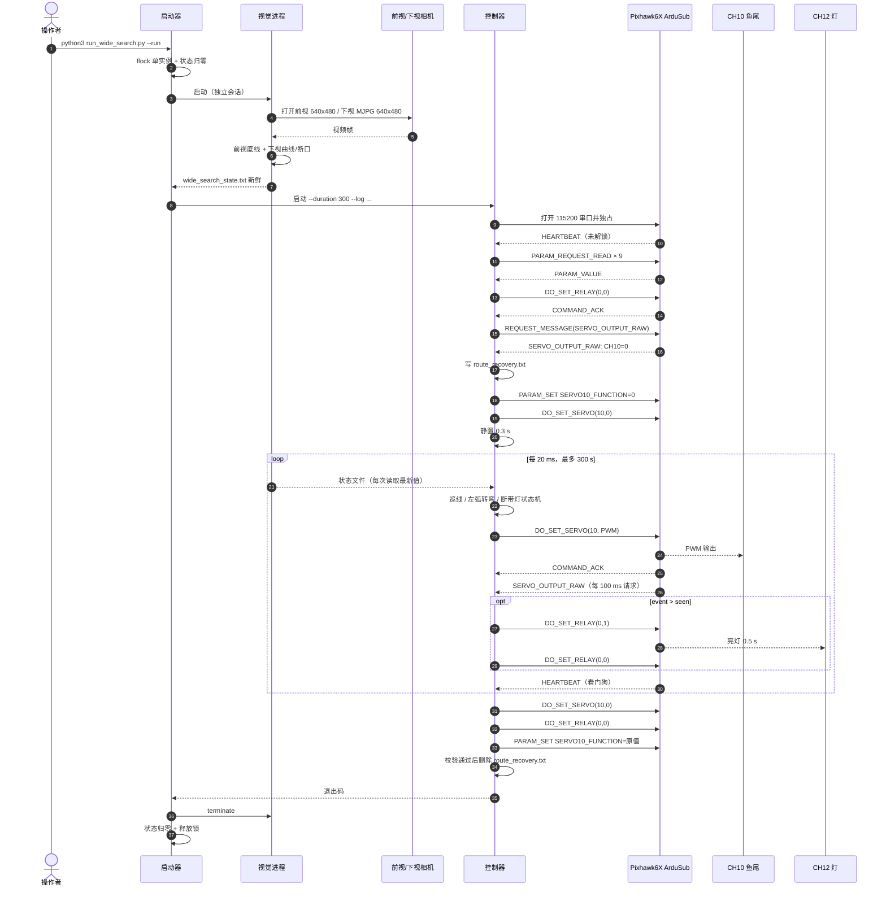

# 程序运行与硬件交互全顺序

本文按**时间顺序**描述从操作者输入命令、视觉启动、飞控建链、执行机构归零、300 s 控制循环，
到正常收尾 / 异常中止 / 断电的完整过程。控制算法细节见
[ARCHITECTURE.md](ARCHITECTURE.md)，硬件参数见 [HARDWARE_IO.md](HARDWARE_IO.md)。

约定：

- “控制器”指 `bin/wide_search_control`；
- “视觉”指 `src/vision/wide_search_vision.py`；
- “启动器”指 `run_wide_search.py`；
- 所有时间戳来自 `time.monotonic()` / C++ `steady_clock`，单位秒；
- 超时与频率来自当前源码，未在本次整理中改动。

## 0. 一页总览

```text
[人工] 上电、检查参数/设备、云台固定 1800、确认未解锁
   │
   ▼
[B] python3 run_wide_search.py --run
   │  flock + 清状态
   ├──► [C] 视觉进程启动：前视相机、下视相机、录制、四画面
   │        └── 持续写 wide_search_state / down_curve_state / gap_light_state
   │
   ├── 等待“前视状态年龄 < 0.5 s”（最多 10 s）
   │
   ▼
[D] 控制器启动：独占串口 → 等 ArduSub 心跳（≤6 s）→ 未解锁检查
   │  校验 CH12 参数 → 初始关灯 → 校验 CH10 参数/范围/50 Hz/输出 0
   │  写 route_recovery.txt → SERVO10_FUNCTION=0 → CH10=0 → 静置 0.3 s
   ▼
[E] 300 s / 50 Hz 主循环（每 20 ms）
   │  读视觉状态 → 巡线或 2 s 左弧转弯 → 断带亮灯 → DO_SET_SERVO(10, PWM)
   │  每 100 ms 请求 SERVO_OUTPUT_RAW；每周期检查心跳、解锁、ACK、调度
   ▼
[F] 到期：CH10=0 → 关灯 → 恢复 SERVO10_FUNCTION → 删恢复记录 → 写 CSV
   │
   ▼
[G] 启动器回收视觉进程 → 状态归零 → 释放锁 → 打印日志
   │
   ▼
[I] 人工确认灯灭、鱼尾中位、无残留进程 → 断电
```

## 1. 时序图



## 2. 阶段 A：上电前的人工准备

这些步骤不在程序内，但决定程序能否安全启动。

| 步骤 | 检查项 | 要求 |
| --- | --- | --- |
| A1 | 整机供电 | 按整机 SOP 上电；推进器/鱼尾周围无人员与异物 |
| A2 | 飞控状态 | 未解锁；遥控器/地面站可用；ArduSub 心跳正常 |
| A3 | CH10 | `SERVO10_FUNCTION` 为 0，或为 7 且 `MNT1_TYPE=0`；`SERVO10_MIN≤1200`、`SERVO10_MAX≥1800`；`SERVO_RATE=50`；当前输出 0 |
| A4 | CH11 云台 | 人工设为 1800；程序不会设置 |
| A5 | CH12 | `SERVO12_FUNCTION=-1`、`RELAY1_FUNCTION=1`、`RELAY1_PIN=53`、`RELAY1_DEFAULT=0`；灯当前灭 |
| A6 | 设备节点 | 两个 `/dev/v4l/by-id/` 相机、`/dev/serial/by-id/` 飞控均存在 |
| A7 | 串口空闲 | 没有 QGC、MAVProxy、其他控制器占用飞控串口 |
| A8 | 恢复记录 | `runtime/route_recovery.txt` 不存在；若存在，先按第 10 节恢复 |
| A9 | 显示 | `DISPLAY`、`XAUTHORITY` 有效，能看到 OpenCV 窗口 |
| A10 | 目录 | `runtime/` 可写；磁盘有空间放录像 |

设备与参数核对命令示例：

```bash
ls -l /dev/v4l/by-id/
ls -l /dev/serial/by-id/
ls -l runtime/route_recovery.txt 2>/dev/null || echo "no recovery record"
```

## 3. 阶段 B：启动器

命令：

```bash
python3 run_wide_search.py --run
# 可选：python3 run_wide_search.py --run --duration 30
```

| 步骤 | 启动器动作 | 产生的效果 |
| --- | --- | --- |
| B1 | 解析参数 | `--run` 缺省为纯预览；`--duration` 限制 2–300 s |
| B2 | 解析根目录 | `ROOT=<repo>`，`RUNTIME=$WIDE_SEARCH_RUNTIME` 或 `<repo>/runtime`，必要时创建 |
| B3 | 设置显示环境 | `DISPLAY` 默认 `:0`；`XAUTHORITY` 优先 `<repo>/.preview_xauthority`，否则 `/home/auv8/.Xauthority` |
| B4 | 获取单实例锁 | 对 `runtime/route_launcher.lock` 做非阻塞 `flock`；失败则退出 1 |
| B5 | 状态归零 | `wide_search_state.txt` 写 `0 -1 0 0`；删除旧 `wide_search_status.txt` |
| B6 | 启动视觉 | `python3 -u src/vision/wide_search_vision.py`，`start_new_session=True`，环境带 `WIDE_SEARCH_RUNTIME` |
| B7 | 预览分支 | 若没有 `--run`：等待视觉退出，不启动控制器 |
| B8 | 等待前视新鲜 | 每 50 ms 读状态；要求 `0 ≤ now-stamp < 0.5`；最多 10 s；视觉提前退出则报错 |
| B9 | 启动控制器 | `bin/wide_search_control --duration N --log <runtime>/wide_search_<时间>.csv`；`cwd=runtime`；stdout/stderr 写入同名 `.log` |
| B10 | 等待控制器 | 控制器结束后打印完整日志；返回值作为启动器返回值 |

> 控制器使用 `cwd=runtime`，因此它读写的 `wide_search_state.txt`、`down_curve_state.txt`、
> `gap_light_state.txt`、`wide_search_status.txt`、`route_recovery.txt` 都落在运行时目录。

## 4. 阶段 C：视觉进程

视觉进程启动后立即进入采集循环，不等控制器。

| 步骤 | 动作 | 说明 |
| --- | --- | --- |
| C1 | 注册 `SIGTERM/SIGHUP` | 转成 `KeyboardInterrupt`，进入 finally |
| C2 | 创建运行时目录 | 发布 `wide_search_state.txt = 0 -1 0 0` |
| C3 | 打开前视相机 | 默认 H264 USB by-id；V4L2；640×480；缓冲 1；失败直接抛错 |
| C4 | 启动下视线程 | 默认 HD USB2.0 by-id；MJPG；640×480；缓冲 1；持续保存最新帧与时间戳；失败则预览显示占位图 |
| C5 | 创建录制 | `runtime/route_video_<时间>/`；`annotated.avi`、`frames.csv`、`down_curve.csv`；更新 `latest_route_recording.txt` |
| C6 | 创建窗口 | 四画面窗口 + `Camera thresholds` 滑条（S max 60、V min 220、下视 S max 60、V min 175） |
| C7 | 进入帧循环 | 每帧：先取时间戳 → `cap.read()` → 前视 ROI/阈值/底线/上视线 → 发布状态 |
| C8 | 处理下视 | 取最新下视帧；若新鲜则曲线拟合 + 断口检测，写 `down_curve_state` / `gap_light_state` |
| C9 | 叠加与录制 | 绘制检测结果、读取控制器状态回显、写 AVI/CSV/关键帧、`imshow` |
| C10 | 退出 | 按 Q/Esc、启动器终止或异常；finally 发布 `0 -1 0 0`、关闭录制、停线程、释放相机、销毁窗口 |

视觉每帧发布的前视状态：

```text
<front_stamp> <bottom_x_fraction> <horizontal 0/1> <any 0/1>
```

- `bottom_x_fraction=-1`：没有找到底线；
- `front_stamp` 是 `cap.read()` **之前**的时间戳，避免阻塞读把旧帧当成新鲜；
- 上视线拟合只用于预览；控制器实际只消费 `x` 和下视状态。

下视每个新鲜帧发布：

```text
<down_stamp> <left 0/1> <strength 0..1>
<down_stamp> <event_counter>
```

下视不新鲜时时间戳写 0；控制器据此关灯、取消左弧候选，并在转弯中直接中止。

## 5. 阶段 D：控制器建链与预检

启动参数：`--duration 300 --log runtime/wide_search_<时间>.csv`，cwd 为 runtime。

| 步骤 | 控制器动作 | 飞控 / 硬件响应 | 超时与失败行为 |
| --- | --- | --- | --- |
| D1 | 打开飞控串口 | `open` + `flock` + `TIOCEXCL`；保存 termios；配置 115200 raw 8N1 | 失败立即退出，不操作硬件 |
| D2 | 等待 ArduSub 心跳 | 接收 `HEARTBEAT`，要求 `compid=1`、`autopilot=ArduPilotMega`、`type=Submarine` | 最多 6 s；超时后 `require_idle` 报心跳超时 |
| D3 | 未解锁检查 | 心跳中的 `base_mode & SAFETY_ARMED` 必须为 0 | 已解锁立即退出 |
| D4 | 校验 CH12 参数 | 读 `SERVO12_FUNCTION=-1`、`RELAY1_FUNCTION=1`、`RELAY1_PIN=53`、`RELAY1_DEFAULT=0` | 每个参数最多 3×1 s；任一不符退出 |
| D5 | 初始关灯 | `COMMAND_LONG(MAV_CMD_DO_SET_RELAY, param1=0, param2=0)` | 1 s 内等 `COMMAND_ACK` 且 accepted；否则退出 |
| D6 | 记录灯基线 | 读 `gap_light_state.txt` 的当前 event 到 `lamp.seen` | 文件缺失不致命，按 0 处理 |
| D7 | 读取 CH10 配置 | `SERVO10_FUNCTION`、`MNT1_TYPE`、`SERVO_RATE`、`SERVO10_MIN`、`SERVO10_MAX` | 每个最多 3×1 s |
| D8 | 校验 CH10 可用 | 范围覆盖 1200–1800；`SERVO_RATE=50`；请求 `SERVO_OUTPUT_RAW` 且 port 0 的 CH10 输出为 0；功能值为 0 或 7；为 7 时 `MNT1_TYPE=0` | 遥测等待 1.5 s；失败退出，不写恢复记录 |
| D9 | 写恢复记录 | 以 `O_CREAT` + `O_EXCL`、模式 0600 创建 `route_recovery.txt`，写 `SERVO10_FUNCTION=<原值>`、`SERVO10_PWM=0`、`SERVO_RATE=<值>`，`fsync` | 文件已存在或写失败：退出，不改变 CH10 |
| D10 | 禁用 CH10 原功能 | 若原功能非 0：`PARAM_SET SERVO10_FUNCTION=0`，等待 `PARAM_VALUE` 回读为 0 | 3×1 s；失败进入收尾 |
| D11 | CH10 回中 | `DO_SET_SERVO(10,0)`；等待 ACK；请求遥测确认输出 0 | ACK 1.5 s、遥测 1.5 s；失败进入收尾 |
| D12 | 静置 | 0.3 s 内持续 `pump` 串口并检查未解锁/心跳 | 异常进入收尾 |

D5 的初始关灯会打印：

```text
CH12_LIGHT=0 time=<monotonic>
```

D8 通过后会打印控制律摘要：

```text
DOWN_CURVE_TURN center=850..900 amplitude=100 freq=5Hz duration=2s; FRONT_FOLLOW left/right=5Hz center=4Hz
```

### 5.1 预检失败时的状态

- D1–D4 失败：串口可能已打开但未改变执行机构；退出时恢复 termios 并释放串口。
- D5 失败：灯可能仍处于原状态；程序退出，需人工确认。
- D7–D8 失败：尚未写恢复记录，CH10 未被改变。
- D9 创建/写入恢复记录失败：可能留下空或不完整记录；CH10 未被改变，但下一次启动可能被该记录阻止，需要人工检查。
- D10 之后失败：恢复记录已存在，进入收尾流程；若收尾也失败，记录保留，必须人工恢复。

## 6. 阶段 E：300 s / 50 Hz 主循环

### 6.1 单个 20 ms 周期的顺序

```text
deadline = start + tick × 0.02
   │
   ├─ 1. 在 deadline 前循环 poll 串口（单次最多 2 ms），每轮 require_idle()
   ├─ 2. 检查命令拒绝计数、ACK 是否停滞（>0.30 s）
   ├─ 3. pump(0) 再处理一次已到达的数据
   ├─ 4. require_idle()（未解锁 + 心跳 <2.5 s）
   ├─ 5. now - deadline > 60 ms ? -> 中止
   ├─ 6. 若落后 ≥20 ms，跳过若干 tick 并重同步 deadline
   ├─ 7. elapsed >= duration ? -> 跳出
   ├─ 8. target(elapsed)：读视觉状态 -> 路由状态机 -> 原子写 status
   ├─ 9. lamp_update()：读灯事件 -> 必要时发 DO_SET_RELAY
   ├─10. 发 DO_SET_SERVO(10, value)
   ├─11. 记录 Sample（时间、lateness、目标 PWM、遥测 PWM、seq）
   ├─12. 每 100 ms 发 REQUEST_MESSAGE(SERVO_OUTPUT_RAW)
   └─13. tick++
```

注意：

- 主循环**不等待** `DO_SET_SERVO` 的 ACK 再发下一条；ACK 由第 1 步的串口泵异步处理。
- 每 100 ms 请求一次 `SERVO_OUTPUT_RAW`，用于记录实际输出和收尾校验，不参与实时闭环。
- 命令拒绝、ACK 停滞（0.3 s）、调度延迟（60 ms）都会让控制器立即停止并进入收尾。
- 控制器每个周期都会读一次状态文件；视觉更新频率通常低于 50 Hz，因此同一帧可能被多个周期复用，但 0.5 s 后即视为过期。

### 6.2 前视巡线子序列

`target()` 读取：

```text
wide_search_state.txt -> stamp, x, horizontal, any
down_curve_state.txt -> down_stamp, left, strength
```

`HorizontalLossRoute::step(now, t, stamp, x, horizontal, any, down_stamp, left, strength)`：

1. 校验前视 `stamp` 有限、`stamp≤now`、`now-stamp≤0.5`、`x∈[-1,1]`，否则抛异常；
2. 校验下视新鲜度；
3. 维护 stage 1/2；
4. 计算 PWM 并返回。

stage=1 时：

| 条件 | PWM |
| --- | --- |
| `x<0` | 0 |
| `0≤x<0.45` | `1300 + 100x/0.45 + 100·sin(2π·5t)` |
| `0.45≤x≤0.55` | `1500 + 100·sin(2π·4t)` |
| `x>0.55` | `1600 + 100(x-0.55)/0.45 + 100·sin(2π·5t)` |

### 6.3 下视左弧转弯子序列

1. 下视新鲜且 `left=1` 时，若 `ready=true`，记录候选起点 `candidate=down_stamp`；
2. 同一段左弧持续 ≥0.1 s：`stage=2`、`turns++`、`center=900`、`turn_start=now`、`turn_until=now+2`、`ready=false`；
3. stage=2 时每周期：
   - `wanted = 900 - 50·strength`（850–900）；
   - `center` 以最大 600 us/s 向 `wanted` 靠拢；
   - 输出 `center + 100·sin(2π·5·(now-turn_start))`；
4. `now≥turn_until` 时回到 stage=1，`ready=false`；
5. 只有看到一次 `left=0` 的新鲜下视样本，才重新 `ready=true`，避免同一段持续左弧反复转弯；
6. stage=2 期间下视超过 0.5 s 不新鲜：抛 `Down camera stale during turn`，立即中止；
7. 任何阶段前视超过 0.5 s 不新鲜：抛 `Front vision stale/invalid`，立即中止。

### 6.4 断带亮灯子序列

每个周期 `lamp_update()`：

1. 若有未完成的继电器命令，先等 ACK；超过 0.3 s 抛 `Lamp ACK timeout`；
2. 读 `gap_light_state.txt` 的 `down_stamp` 与 `event`；
3. `GapLamp::step(now, down_stamp, event)`：
   - 灯亮且（数据不新鲜或已到 `until`）→ 返回 0（关灯），并令 `seen=event`；
   - 数据不新鲜 → 返回 -1；
   - `event<seen` → 同步 `seen=event`；
   - `event>seen` 且灯未亮 → 亮灯，`until=now+0.5`，返回 1，并令 `seen=event`；
4. 返回 0 或 1 时发 `DO_SET_RELAY(0, value)`，打印：

```text
CH12_LIGHT=<0|1> time=<monotonic>
```

视觉侧产生 `event` 的条件是断口连续确认 0.1 s；需要连续 0.5 s 无断口才重新允许下一次事件。因此一次断带通常对应一次约 0.5 s 的亮灯。

### 6.5 周期内的硬件交互频率

| 交互 | 频率 / 触发 | 说明 |
| --- | --- | --- |
| `DO_SET_SERVO(10, PWM)` | 50 Hz | 每个 20 ms 周期一条 |
| `DO_SET_RELAY(0, 0/1)` | 事件驱动 | 断带触发/0.5 s 到期；同一时刻至多一条在途 |
| `REQUEST_MESSAGE(SERVO_OUTPUT_RAW)` | 10 Hz | 每 100 ms 一次 |
| `HEARTBEAT` 接收 | 飞控约 1 Hz | 用于解锁/心跳看门狗 |
| `COMMAND_ACK` 接收 | 每个命令 | 舵机拒绝/ACK 停滞会中止 |
| `SERVO_OUTPUT_RAW` 接收 | 请求后 | 记录 CH10 实际输出，收尾校验 |
| `STATUSTEXT` 接收 | 事件驱动 | 解析并入队；当前版本未调用 `print_notices()`，不会显示 |

## 7. 阶段 F：正常收尾

当 `elapsed≥duration`（或循环内判断到期）：

| 步骤 | 控制器动作 | 输出 / 校验 |
| --- | --- | --- |
| F1 | 跳出主循环 | — |
| F2 | `DO_SET_SERVO(10,0)` | 1.5 s 内等 ACK；请求遥测确认 0 |
| F3 | 静置 0.2 s | 持续 pump + `require_idle` |
| F4 | 打印运行摘要 | `ROUTE_TIME_LIMIT duration=... stage=... turns_completed=... PWM_RATE=50Hz` |
| F5 | 关灯 | `DO_SET_RELAY(0,0)`，1 s 内 ACK；打印 `LAMP_OFF_CONFIRMED` |
| F6 | 再次回中 | `DO_SET_SERVO(10,0)` + 遥测确认 0 |
| F7 | 恢复功能 | `PARAM_SET SERVO10_FUNCTION=<原值>`，回读确认 |
| F8 | 打印安全结果 | `STOP=1 RESTORE_FUNCTION=<原值> confirmed=1` |
| F9 | 删除恢复记录 | 仅当 F6 与 F7 都成功 |
| F10 | 写报告 | CSV + `SAMPLES=... SKIPPED=... MAX_LATENESS_MS=... INTERVAL_P50_MS=... P99_MS=... MAX_MS=... LOG=...` |
| F11 | 退出 | 正常 0；任一安全校验失败 1，恢复记录保留 |

### 7.1 正常日志示例

```text
Started 300-second route. Log: /.../runtime/wide_search_20251022_232700.log
CH12_LIGHT=0 time=12345.678
DOWN_CURVE_TURN center=850..900 amplitude=100 freq=5Hz duration=2s; FRONT_FOLLOW left/right=5Hz center=4Hz
DOWN LEFT ARC; FIXED 2s TURN center=850..900us +/-100 5Hz time=12.345
FIXED 2s TURN COMPLETE; FOLLOW time=14.345
CH12_LIGHT=1 time=20.100
CH12_LIGHT=0 time=20.600
ROUTE_TIME_LIMIT duration=300s stage=1 turns_completed=2 PWM_RATE=50Hz
CH12_LIGHT=0 time=303.200
LAMP_OFF_CONFIRMED
STOP=1 RESTORE_FUNCTION=0 confirmed=1
SAMPLES=15000 SKIPPED=0 MAX_LATENESS_MS=3.2 INTERVAL_P50_MS=20.0 P99_MS=20.4 MAX_MS=21.0 LOG=/.../runtime/wide_search_20251022_232700.csv
```

启动器在正常结束后会把整个 `.log` 再打印一遍到终端，因此终端中会看到两次。

## 8. 阶段 G：启动器回收

| 步骤 | 启动器动作 |
| --- | --- |
| G1 | 控制器正常返回：打印日志全文，返回控制器的退出码 |
| G2 | 若控制器仍在运行（Ctrl+C/异常）：发 `SIGINT`，最多等 30 s 让它完成收尾 |
| G3 | 30 s 未退出：`terminate`，2 s 后仍不退出则 `kill` |
| G4 | 视觉仍在运行：`terminate`，最多等 3 s，必要时 `kill` |
| G5 | 把 `wide_search_state.txt` 重置为 `0 -1 0 0` |
| G6 | 释放 `route_launcher.lock` |
| G7 | 若 `route_recovery.txt` 仍存在，打印 WARNING |

预览模式下，`Ctrl+C` 或 Q/Esc 后的回收顺序相同（只少了控制器部分）。

## 9. 阶段 H：异常、中断与恢复

### 9.1 `Ctrl+C` / SIGTERM / SIGHUP

```text
操作者 Ctrl+C
  -> 启动器 KeyboardInterrupt
  -> finally: 给控制器 SIGINT
  -> 控制器置 interrupted=1
  -> 下一次 require_idle() 抛 "Interrupted"
  -> 内层 catch 打印 "TEST_STOPPED Interrupted"
  -> 关灯 -> CH10=0 -> 恢复 SERVO10_FUNCTION -> 删恢复记录（仅当 CH10 与功能恢复都成功）
  -> 写 CSV -> 退出码 1
  -> 启动器等待 ≤30 s，终止视觉，状态归零，释放锁
```

建议只按一次 `Ctrl+C`。连续多次可能打断启动器等待，导致控制器被提前终止，恢复记录保留。

### 9.2 运行中异常

| 异常 | 检测点 | 控制器行为 | 恢复记录 |
| --- | --- | --- | --- |
| 运行中被解锁 | 每周期 `require_idle` | 中止 + 收尾 | 收尾成功则删除 |
| 心跳 >2.5 s | 每周期 `require_idle` | 中止 + 收尾 | 收尾成功则删除 |
| 前视状态 >0.5 s | `route.step` | 中止 + 收尾 | 收尾成功则删除 |
| 转弯中下视 >0.5 s | `route.step` | 中止 + 收尾 | 收尾成功则删除 |
| 非转弯下视不新鲜 | `fresh=false` | 取消左弧候选、关灯、继续巡线 | 不影响 |
| 舵机命令被拒 | `rejected` 计数 | 中止 + 收尾 | 收尾成功则删除 |
| ACK 停滞 >0.3 s | 主循环 | 中止 + 收尾 | 收尾成功则删除 |
| 调度延迟 >60 ms | 主循环 | 中止 + 收尾 | 收尾成功则删除 |
| 继电器 ACK >0.3 s | `lamp_update` | 中止 + 收尾 | 收尾成功则删除 |
| 串口断开 | `poll` | 抛异常；可能无法收尾 | 可能保留 |
| 视觉进程崩溃 | 状态过期 | 中止 + 收尾 | 收尾成功则删除 |
| 控制器被 `kill -9` / 掉电 | 无 | 无收尾 | 保留 |
| 启动器被 `kill -9` | 无 | 控制器可能继续到 300 s 上限 | 取决于控制器是否正常收尾 |

### 9.3 人工恢复流程

当 `runtime/route_recovery.txt` 存在时，控制器会拒绝下一次启动。按以下顺序处理：

1. 确认机体固定、周围安全、人员远离鱼尾；
2. 用地面站确认飞控**未解锁**；
3. 读取 `route_recovery.txt`：
   ```text
   SERVO10_FUNCTION=<原值>
   SERVO10_PWM=0
   SERVO_RATE=<值>
   ```
4. 用 QGC/MAVProxy 确认 CH10 输出为 0；若不为 0，先发 `DO_SET_SERVO(10,0)`；
5. 确认 `SERVO10_FUNCTION` 已恢复到记录值；若没有，先 `PARAM_SET` 恢复并回读；
6. 确认灯已灭；必要时手动 `DO_SET_RELAY(0,0)`；
7. 以上全部确认后，才删除 `route_recovery.txt`；
8. 查看最近的 `.log` / `.csv`，查明中止原因；
9. 先跑 `python3 run_wide_search.py` 预览，确认视觉正常，再考虑短时长 `--run`。

> 恢复记录是最后一道保险：**不要**为了“让程序能启动”而直接删除它。

## 10. 阶段 I：退出与断电

1. 确认启动器已退出，终端回到提示符；
2. 确认没有残留进程：
   ```bash
   pgrep -af 'wide_search_control|wide_search_vision|run_wide_search'
   ```
3. 查看 `runtime/wide_search_*.log` 末尾的 `STOP=` / `RESTORE_FUNCTION=` / `LAMP_OFF_CONFIRMED`；
4. 确认 `runtime/route_recovery.txt` 不存在；
5. 目视确认灯灭、鱼尾处于中位/无动作；
6. 按整机 SOP 断电，最后断开相机/串口。

## 11. MAVLink 交互清单

出站系统号/组件号：`245/190`。控制器只解析来自目标飞控 `sysid`、`compid=1` 的消息。

| 阶段 | 方向 | 消息 | 关键字段 | 频率 / 超时 | 期望 |
| --- | --- | --- | --- | --- | --- |
| D2 | FC→控制器 | `HEARTBEAT` | `autopilot=ArduPilotMega`、`type=Submarine`、`base_mode` | 约 1 Hz | 识别系统；未解锁 |
| D4/D7 | 控制器→FC | `PARAM_REQUEST_READ` | `param_id`、`param_index=-1` | 每参数最多 3 次，每次 1 s | `PARAM_VALUE` |
| D4/D7 | FC→控制器 | `PARAM_VALUE` | `param_id`、`param_value` | 响应 | 与要求一致 |
| D10/F7 | 控制器→FC | `PARAM_SET` | `SERVO10_FUNCTION`、`MAV_PARAM_TYPE_INT16` | 最多 3 次，每次 1 s | 回读等于目标值 |
| D5/F5 | 控制器→FC | `COMMAND_LONG(DO_SET_RELAY)` | `param1=0`（实例）、`param2=0/1` | 1 s / 0.3 s | `COMMAND_ACK accepted` |
| D11/F2 | 控制器→FC | `COMMAND_LONG(DO_SET_SERVO)` | `param1=10`、`param2=PWM` | 1.5 s | `COMMAND_ACK accepted` |
| E | 控制器→FC | `COMMAND_LONG(DO_SET_SERVO)` | CH10、PWM | 50 Hz | ACK 持续到达 |
| E | 控制器→FC | `COMMAND_LONG(REQUEST_MESSAGE)` | `param1=SERVO_OUTPUT_RAW` | 10 Hz | `SERVO_OUTPUT_RAW` |
| E/F | FC→控制器 | `SERVO_OUTPUT_RAW` | `port=0`、`servo10_raw` | 请求后 | 用于记录/校验 |
| E | FC→控制器 | `COMMAND_ACK` | `command`、`result` | 每个命令 | 非 accepted 即中止 |
| 全程 | FC→控制器 | `STATUSTEXT` | `text` | 事件驱动 | 解析入队；当前版本不会显示 |

**不会发送**：`MAV_CMD_COMPONENT_ARM_DISARM`、`SET_MODE`、`RC_CHANNELS_OVERRIDE`、
`MANUAL_CONTROL`、航点/深度/航向命令。

## 12. 跨进程文件时序

| 时刻 | 视觉 | 控制器 | 启动器 |
| --- | --- | --- | --- |
| 启动 | 写 `wide_search_state.txt=0 -1 0 0` | — | 写同文件、删旧 status |
| 预热 | 每帧写 front/down/gap 状态；写录像/CSV | — | 每 50 ms 检查 front 新鲜度 |
| 预热完成 | 继续更新 | 启动，读状态文件 | 启动控制器，等待 |
| 预检 | 继续更新 | 读 gap 基线；写 `route_recovery.txt` | 等待 |
| 运行 | 每帧写三份状态；读 status 回显 | 每 20 ms 读状态、写 status；每 100 ms 请求遥测 | 等待 |
| 收尾 | 继续预览直到被终止 | 关灯、回中、恢复、删恢复记录、写 CSV | 等控制器；终止视觉；状态归零 |
| 退出 | 关闭录像/相机 | 关闭串口/恢复 termios | 释放锁 |

## 13. 时间预算与实时性

| 项目 | 数值 | 说明 |
| --- | --- | --- |
| 启动器等待前视新鲜 | 最多 10 s | 每 50 ms 检查，年龄 <0.5 s |
| 控制器等待心跳 | 最多 6 s | 识别 ArduSub |
| 心跳新鲜窗口 | 2.5 s | 超过即中止 |
| 视觉状态新鲜窗口 | 0.5 s | 前视/下视/灯事件 |
| 参数读取 | 每次最多 1 s，3 次 | 单个参数 |
| 舵机 ACK | 1.5 s | 逐命令确认 |
| 遥测确认 | 1.5 s | `verify_output` |
| 主循环 | 20 ms（50 Hz） | 绝对截止时间 |
| 调度容差 | 60 ms | 超过即中止 |
| 左弧确认 | 0.1 s | 连续左弧 |
| 固定转弯 | 2 s | 5 Hz |
| 亮灯 | 0.5 s | 断带事件 |
| 断带重新武装 | 0.5 s | 连续无断口 |
| 任务上限 | 300 s | 硬限制 |
| 中断后等待收尾 | 最多 30 s | 启动器 |
| 视觉终止等待 | 最多 3 s | 启动器 |

## 14. 屏幕与日志判读

预览叠加：

- `Stage 1`：巡线；`Stage 2`：固定 2 s 转弯；
- `PWM <n>`：控制器最近一次目标输出；
- `Bottom xx.x%`：前视底线横向位置；
- `Horizontal True/False`：上视线是否拟合成功（仅显示）；
- `Left=... k=... dx=...`：下视左弧、曲率、横向偏移；
- `Gap True/False Event n`：断口与事件计数；
- 绿色线：上视线；红点：底部线；红色短线段：断口；蓝色竖线：45%/55% 分界。

控制器日志关键字：

| 关键字 | 含义 |
| --- | --- |
| `CH12_LIGHT=0/1` | 已下发继电器命令 |
| `LAMP_OFF_CONFIRMED` | 收尾关灯 ACK 成功 |
| `DOWN LEFT ARC...` | 进入固定 2 s 转弯 |
| `FIXED 2s TURN COMPLETE; FOLLOW` | 转弯结束回到巡线 |
| `ROUTE_TIME_LIMIT` | 正常到期摘要 |
| `STOP=1` | CH10 遥测确认 0 |
| `RESTORE_FUNCTION=... confirmed=1` | 原功能恢复成功 |
| `TEST_STOPPED ...` | 内层循环异常中止 |
| `ERROR ...` | 预检/建链/未捕获异常 |
| `SAMPLES=...` | CSV 采样统计 |
