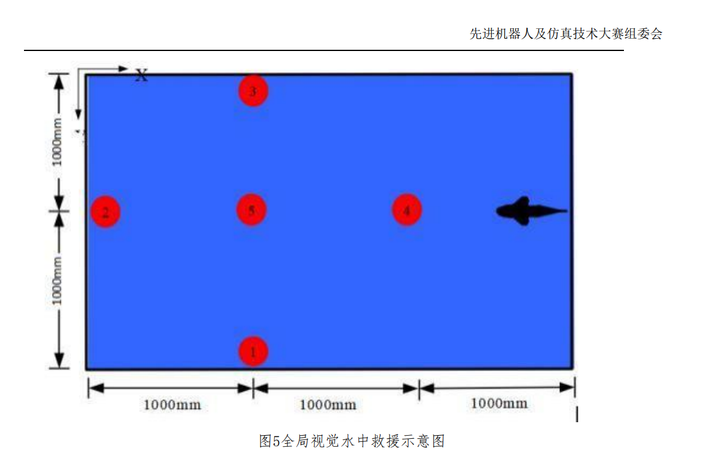
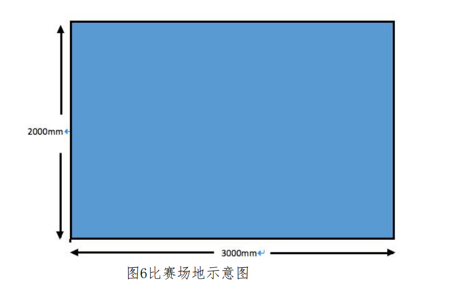
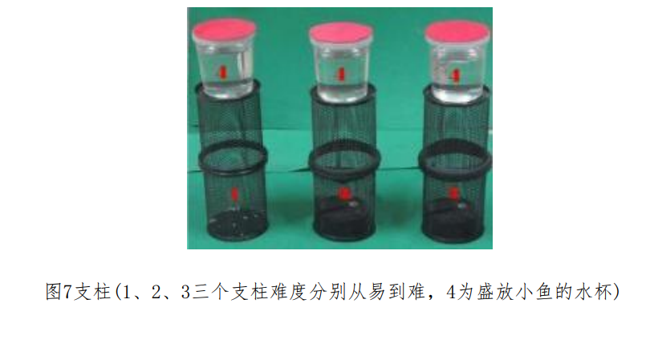

> 项目原先是一个同机器，意味这设备连接方式完全一致，可以直接移植相关硬件交互代码

（三）科目三：水中救援
1. 科目内容
参赛队各派一条自主机器鱼按照抽签顺序参加比赛。水池中安放5个圆筒形支柱，其中编号1、3、4的支柱为最低难度的支柱，编号为2为中等难度的支柱，编号5为最高难度的支柱。每个支柱顶部放置一个装有真鱼的透明盒子，整个盒子代表受困待救的小鱼。支柱的初始位置如6所示。机器鱼从水池右侧池壁中心点出发，具体位置如图5所示，逐一冲撞支柱，使得支柱顶部的盒子能够落入水中，代表营救受困的小鱼。

机器鱼从水池右侧池壁中心点出发，逐一冲撞支柱，使得支柱顶部的盒子能够落入水中，代表成功营救受困的小鱼。
2. 比赛规则
(1)参赛队要求
每队最多由5名队员组成，其中一人为队长，最多两名指导老师。
(2)机器人要求
硬件设备为自主机器鱼。每条机器鱼重量不得超过3kg；在不受挤压的情况下，机器鱼必须能够放进一个底面半径为120mm，高为450mm的圆筒里面，且保证机器鱼机身安全不受损伤。
(3)比赛场地准备
1 水池：
水池内部的长方形区域为最终的有效比赛场地，不包括水池壁，有效场地尺寸为3m×2m×0.6m（长×宽×高），水深为20cm。比赛场地如图6所示，由组委会统一提供。

2 道具：
圆筒形支柱（以下简称支柱）由笔筒（直径为80+5mm，高度为190+10mm）制成，水杯规格为高度84+10mm，直径为84+10mm，每个水杯中的水量保持统一，注满水杯。根据支柱难度分为三个等级，最低难度的支柱由接口粘合的两个笔筒叠制而成，中等难度的支柱由笔筒和配重物构成，配重物为0.25kg。最高难度的支柱由笔筒和配重物构成，配重物为0.5kg，如图7所示。为保持一致性，现场比赛道具由大赛组委会统一提供。

(4)比赛时间
比赛时间为5分钟，比赛只进行一次，比赛过程中不得暂停。
(5)计分规则
自主视觉水中救援比赛项目由主裁进行计分：1 比赛前机器鱼必须静止，裁判鸣哨后方能启动机器鱼。不得遥控机器鱼，如果发现手动遥控，则取消其比赛资格。2 比赛时间为5分钟，采用计分规则。编号1、2、3的支柱上的盒子落入水中分别记2分，编号4的支柱上的盒子落入水中记3分，编号5的支柱上的盒子落入水中记5分。若在5分钟内完成比赛，则记录完成比赛所用时间。以所用时间长短排序，时间最短者获得水中救援科目第一名，以此类推。
3 若在5分钟内未完成比赛，则比较各队得分高低进行排名。若得分相同，则依据第一个落入水中盒子所用的时间长短计算名次，以此类推。4 比赛时间到达5分钟时，机器鱼必须自动停止，否则扣1分。